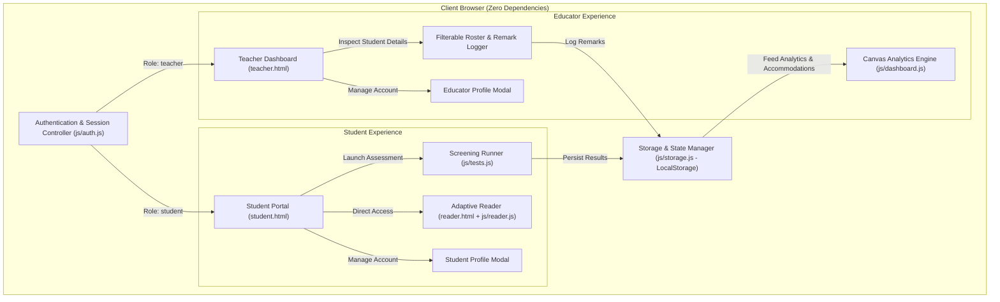

[README.md](https://github.com/user-attachments/files/35103338/README.md)
# 🌟 LexiLens

> **Empowering Neurodivergent Learners with Early Educational Screening & Adaptive Reading Assistance**

[](#technologies-used)
[](#technologies-used)
[](#technologies-used)
[](#technologies-used)
[](#technologies-used)
[-success.svg)](#technologies-used)

---

## 📖 Table of Contents

- [Project Overview](#-project-overview)
- [Problem Statement](#-problem-statement)
- [System Architecture](#-system-architecture)
- [Key Features](#-key-features)
  - [1. Authentication & Role Switcher](#1-authentication--role-switcher)
  - [2. Student Portal & Screening Activities](#2-student-portal--screening-activities)
  - [3. Adaptive Reader](#3-adaptive-reader)
  - [4. Educator Analytics Dashboard](#4-educator-analytics-dashboard)
- [Technologies Used](#-technologies-used)
- [Installation & Quick Start](#-installation--quick-start)
  - [Demo Accounts](#demo-accounts)
- [Screenshots & UI Walkthrough](#-screenshots--ui-walkthrough)
- [Future Improvements & Roadmap](#-future-improvements--roadmap)
- [Developer Information](#-developer-information)
- [License](#-license)

---

## 🔍 Project Overview

**LexiLens** is an accessible, client-side educational screening and assistive reading web platform designed to support students with learning differences such as dyslexia, visual crowding, and tracking challenges.

Unlike clinical diagnostic tools, LexiLens emphasizes **gentle, low-stakes educational screening** paired immediately with **actionable reading accommodations**. The platform bridges the gap between students and educators through a cohesive three-pillar architecture:

1. **Student Portal**: Gamified, low-pressure cognitive exercises that evaluate letter orientation recognition, visual focus tracking, and typing flow.
2. **Adaptive Reader**: A customizable digital reader that mitigates visual stress using specialized typography (OpenDyslexic, Lexend), color tints, reading rulers, single-line focus isolation, bionic reading, and Text-to-Speech (TTS).
3. **Educator Dashboard**: Comprehensive class analytics, visual distribution charts, student history progression, and accommodation tracking to empower teachers in classroom intervention planning.

---

## 🎯 Problem Statement

According to the International Dyslexia Association, an estimated **15% to 20%** of school-aged children experience language-based learning disabilities, with dyslexia being the most prevalent. 

### Critical Challenges:
* **Delayed Identification**: Formal clinical diagnostic screenings often take months or years to schedule, leaving struggling readers unassisted during critical foundational learning stages.
* **Intimidating Assessments**: Traditional evaluations induce anxiety, test fatigue, and cognitive resistance in young students.
* **Disconnection from Tools**: Even after identification, students frequently lack immediate, everyday digital reading tools tailored to their unique sensory and visual needs.
* **Educator Visibility Gaps**: Teachers managing classrooms of 30+ students rarely have quick, consolidated visual data showing which students struggle with specific reading mechanics (e.g., letter confusion vs. visual tracking drift).

### The LexiLens Solution:
LexiLens democratizes accessible literacy. Built completely without heavy frameworks or server prerequisites, it provides **zero-barrier accessibility** directly inside any web browser—enabling instant screening, immediate customized reading relief, and centralized teacher tracking.

---

## 🏗️ System Architecture



---

## ✨ Key Features

### 1. Authentication & Role Switcher
* **Dual Roles**: Supports dedicated pathways for both **Students** and **Educators**.
* **Instant Demo Logins**: Pre-configured single-click demo buttons (`Teacher Demo` and `Student Demo`) for effortless evaluations without manual typing.
* **Show/Hide Password Controls**: Interactive eye toggle on all password inputs.
* **Persistent Sessions**: Automatic route protection (`protectPage`) ensuring users stay securely in their respective workspaces.

### 2. Student Portal & Screening Activities
* **Dynamic Progress Ring**: SVG circular task indicator reflecting completed screening tasks in real-time.
* **Support Status Badges**: Dynamic status calculation (*On Track*, *Needs Attention*, *Needs High Support*) based on composite performance.
* **Three Gentle Screening Activities**:
  1. **Letter Flip & Recognition**: Evaluates reversible letter confusion (e.g., `b`, `d`, `p`, `q`) through timed, gentle pattern choices.
  2. **Focus Tracking**: Measures ocular pursuit and visual fixation against drifting targets across the screen.
  3. **Typing Flow & Motor Rhythm**: Assesses keystroke cadence, pause latency, and typing accuracy.
* **Student Self-Profile**:
  * View and update Full Name, Grade/Class, and Roll Number.
  * Direct password modification with show/hide toggle.
  * Real-time counter of completed assessments.

### 3. Adaptive Reader
* **Dyslexia-Centric Typography**: One-click switching between **OpenDyslexic**, **Lexend**, **Atkinson Hyperlegible**, and system typefaces.
* **Precision Layout Sliders**: Real-time manipulation of font size, line height, letter spacing, and word spacing.
* **Sensory Tint Overlays**: Color background presets designed to reduce visual glare:
  * Warm Cream (Classic paper tone)
  * Calm Mint (Soothing green)
  * Soft Rose (Warm pink)
  * High-Contrast Dark Mode
* **Visual Crowding Reduction**:
  * **Reading Ruler**: Movable highlight bar that tracks cursor movement over text lines.
  * **Single-Line Focus Mode**: Darkens non-active sentences to help readers track paragraph flow without losing their place.
  * **Bionic Reading Mode**: Algorithmically bolds the initial syllables of words to anchor saccadic eye movements.
* **Integrated Text-to-Speech (TTS)**: Native browser speech synthesis with **Play**, **Pause / Resume toggle**, and **Stop** functionality.

### 4. Educator Analytics Dashboard
* **Classroom Overview Metrics**: Instant KPIs reporting total enrolled students, screening completion rates, and support tier distributions.
* **Interactive Visual Analytics (Canvas-based)**:
  * **Skill Breakdown Bar Chart**: Class-wide averages for Letter Recognition, Focus Tracking, and Typing Flow.
  * **Support Level Donut Chart**: Breakdown of students categorized across Tier 1, Tier 2, and Tier 3.
* **Dynamic Student Roster**:
  * Instant search by student name or email.
  * Dropdown filtering by Support Tier (*All*, *Needs Support*, *Needs Attention*, *On Track*).
  * Sortable by Overall Index or alphabetical order.
* **Student Detail Drawer**:
  * Comprehensive skill breakdown scores.
  * Historical screening progression trend graph.
  * Tailored classroom accommodation recommendations (e.g., extra time, oral instructions, high-contrast worksheets).
  * **Teacher Remarks Logger**: Add, view, and delete individualized observational notes.
* **Educator Profile**:
  * View and edit Full Name and Title/Designation.
  * Active student enrollment indicator.
  * Account password update with toggle visibility.

---

## 💻 Technologies Used

| Technology | Purpose |
| :--- | :--- |
| **HTML5** | Semantic structure, accessible form controls, modals, and SVG graphics. |
| **CSS3** | Modern Flexbox, CSS Grid layouts, CSS custom properties (`:root`), animations, and responsive breakpoints. |
| **Vanilla JavaScript (ES6+)** | Pure client-side logic, DOM manipulation, scoring calculations, and dynamic SVG circle calculations. |
| **Web Speech API (`SpeechSynthesis`)** | Native browser text-to-speech engine providing voice playback without external audio APIs. |
| **HTML5 Canvas API** | Lightweight custom charting engine rendering interactive bar charts, donut charts, and trend lines. |
| **Web Storage API (`localStorage`)** | Local state persistence for user records, screening history, remarks, and reader preferences. |
| **Google Fonts** | Inclusion of scientifically validated accessible typography (*Lexend*, *Atkinson Hyperlegible*). |

---

## 🚀 Installation & Quick Start

LexiLens requires **zero backend servers, no database installations, and zero `npm install` packages**. It runs in any modern browser out-of-the-box.

### Option 1: Direct File Launch
1. Clone or download the repository to your local machine:
   ```bash
   git clone https://github.com/your-username/lexilens.git
   ```
2. Navigate into the project directory:
   ```bash
   cd lexilens
   ```
3. Open `index.html` directly in your browser:
   * **Windows**: Double-click `index.html` or run `start index.html` in PowerShell.
   * **macOS**: Run `open index.html` in Terminal.
   * **Linux**: Run `xdg-open index.html`.

### Option 2: Run with a Lightweight Local Server (Recommended)
If you prefer testing over `localhost`:

* **Using Node (npx serve)**:
  ```bash
  npx serve .
  ```
* **Using Python 3**:
  ```bash
  python -m http.server 8000
  ```
* **Using VS Code Live Server**: Right-click `index.html` and choose **"Open with Live Server"**.

Visit `http://localhost:8000` (or the port specified) in your browser.

---

### Demo Accounts

You can log in instantly using the demo buttons on the login page or with the credentials below:

| Role | Email | Password | Access Highlights |
| :--- | :--- | :--- | :--- |
| **Teacher / Educator** | `teacher@demo.com` | `1234` *(or `teacher123`)* | Class roster, analytics charts, student inspection drawer, observation remarks |
| **Student (Demo 1)** | `student@demo.com` | `1234` *(or `student123`)* | 3 screening activities, progress ring, profile settings, Adaptive Reader |
| **Student (Demo 2)** | `ananya@demo.com` | `1234` | Pre-screened student profile with active support plan |

---

## 📸 Screenshots & UI Walkthrough

*(Screenshots can be added directly into an `assets/screenshots/` folder)*

| Screen | Description | Suggested Screenshot Path |
| :--- | :--- | :--- |
| **Authentication Portal** | Clean sign-in interface with role toggle, password reveal, and one-click demo access. | `assets/screenshots/01-login.png` |
| **Student Portal** | Dashboard featuring circular progress tracking, assessment cards, and personalized profile badge. | `assets/screenshots/02-student-dashboard.png` |
| **Screening Activities** | Interactive exercises testing letter reversal, focus fixation, and typing cadence. | `assets/screenshots/03-screening-task.png` |
| **Adaptive Reader** | Text reading interface with ruler guide, font adjustments, color filters, and TTS audio controls. | `assets/screenshots/04-adaptive-reader.png` |
| **Teacher Analytics** | Visual educator dashboard displaying class-wide distribution charts and roster filters. | `assets/screenshots/05-teacher-analytics.png` |
| **Student Detail Inspection** | Slide-in drawer detailing individual skill percentages, timeline charts, and classroom recommendations. | `assets/screenshots/06-student-inspection.png` |

---

## 🔮 Future Improvements & Roadmap

- [ ] **Multi-Language Phoneme Screening**: Expansion into phonemic awareness activities across multiple regional languages.
- [ ] **Document Importer**: Allow students to drag-and-drop `.pdf`, `.docx`, and `.epub` textbooks directly into the Adaptive Reader.
- [ ] **Speech-to-Text Screening**: Evaluate oral reading fluency and word decoding latency using the Web Speech Recognition API.
- [ ] **Educator LMS Sync**: Integration with Google Classroom, Canvas, and Clever rosters via REST API endpoints.
- [ ] **Gamified Badges & Streaks**: Positive reinforcement incentives, reading milestone stickers, and habit-building achievements for students.
- [ ] **Offline PWA Support**: Service Worker caching enabling full functionality in offline or low-connectivity classroom environments.

---

## 👨‍💻 Developer Information

* **Project Name**: LexiLens
* **Platform**: Assistive EdTech & Accessibility Screening
* **Architecture**: Vanilla Web Technologies (HTML5 / CSS3 / JavaScript)
* **Lead Developer / Author**: *[Add Your Name / Organization Here]*
* **Contact & Socials**:
  * GitHub: *[@your-github-username](https://github.com/)*
  * LinkedIn: *[Your LinkedIn Profile](https://linkedin.com/)*
  * Email: *your-email@example.com*

---

## 📄 License

This project is open-source and available under the [MIT License](LICENSE).  
*LexiLens is designed for supportive educational screening and classroom accommodation planning; it is not intended as a substitute for professional clinical medical diagnosis.*

